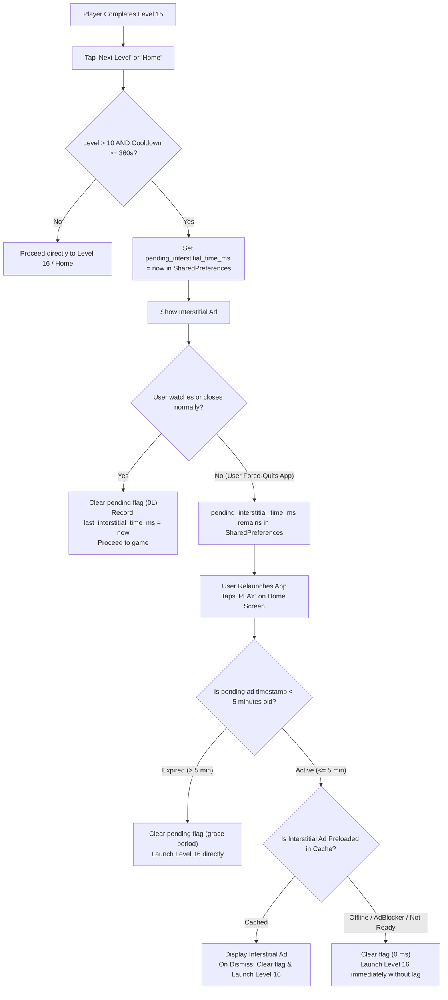

# Arrow Away: Tap Logic Puzzle — Comprehensive Advertising Specification

**Document Version:** 1.0.0  
**Target Release:** Version `1.0.2` (VersionCode `3`)  
**Technology Stack:** Native Android (Kotlin), Jetpack Compose, Google Mobile Ads SDK (AdMob `23.x`), Firebase Remote Config  
**Last Updated:** November 2026  

---

## 1. Executive Summary & Monetization Philosophy

The advertising architecture in **Arrow Away: Tap Logic Puzzle** is engineered around a **player-first, retention-optimized monetization model**. The primary design objective is to generate consistent ad revenue while rigorously preserving puzzle flow, user delight, and high long-term retention.

### Key Monetization Pillars:
1. **Onboarding Grace Period (Levels 1–10 Ad-Free):**  
   New players solve their first 10 levels with **zero interstitial ads**. This guarantees high Day-1 conversion, minimal churn during early levels, and immediate player immersion.
2. **Paced Interstitials (Strict 6-Minute Cooldown):**  
   Interstitial ads only trigger at natural completion moments (level victory) and only if at least **6 minutes (360 seconds)** have elapsed since the last interstitial ad.
3. **No Mid-Puzzle Interruptions:**  
   Players are never interrupted during active puzzle solving. Pausing, restarting, or abandoning a level back to the Home screen will **never** trigger an interstitial ad.
4. **100% Opt-In Rewarded Ads:**  
   Players who run out of lives or need hints can freely choose to watch a rewarded video. Rewarded ads have **no cooldown restrictions** and give immediate, tangible in-game utility.
5. **Robust Anti-Bypass System:**  
   Players cannot bypass interstitial ads by force-quitting the application. Interrupted ads are gracefully presented on the next session within a 5-minute window.
6. **Active Gameplay vs. Ad Isolation:**  
   All active puzzle timers and stars stop ticking the instant an ad opens. Time spent inside ads (including interactive playable puzzle ads) is **strictly excluded** from gameplay metrics.

---

## 2. Ad Inventory & Placements Summary

| # | Ad Placement Name | Ad Format | AdMob Unit ID (Production) | Screen / Trigger | Frequency / Pacing | User Experience / Action | Reward / Result |
|---|---|---|---|---|---|---|---|
| **1** | `banner_bottom` | **Adaptive Banner** (320×50dp) | `ca-app-pub-8262479902787896/1869486914` | Settings, Daily Challenge, Victory Screen | Continuous when screen is open | Passive, docked safely at screen bottom | None (Impression) |
| **2** | `level_transition` | **Interstitial Ad** (Static/Video/Playable) | `ca-app-pub-8262479902787896/8466684854` | Victory Screen ("Next Level" or "Home") | Level > 10; Min 6 min (360s) cooldown | Full-screen transition; Skippable after 5s | Moves to next level / Home |
| **3** | `daily_transition` | **Interstitial Ad** (Static/Video/Playable) | `ca-app-pub-8262479902787896/8466684854` | Daily Challenge Victory ("Continue" / "Home") | Min 6 min (360s) cooldown | Full-screen transition; Skippable after 5s | Returns to Daily screen |
| **4** | `lives_expiry` | **Rewarded Video** (Full-screen Video) | `ca-app-pub-8262479902787896/4324434877` | Game Over / Out of Lives Dialog | Unlimited / On demand | Opt-in dialog with "Watch Ad" badge | Refills **+3 Lives** |
| **5** | `hint_refill` | **Rewarded Video** (Full-screen Video) | `ca-app-pub-8262479902787896/4324434877` | In-Game Hint Button (When Hints = 0) | Unlimited / On demand | Opt-in modal prompt | Grants **+1 Hint** |

---

## 3. Detailed Ad Formats & Layout Specifications

### 3.1 Adaptive Banner Ads (`banner_bottom`)
* **Format:** Google AdMob Adaptive Banner (standard 50dp height, fills horizontal width up to max container width).
* **Placement & Screens:**
  1. [`SettingsScreen.kt`](file:///c:/Projects/Personal/Games/arrow%20decode/arrow%20decode/arrow_native/app/src/main/java/com/arrowaway/puzzle/ui/screens/SettingsScreen.kt) — Positioned at the bottom of the settings card list with 4dp vertical padding.
  2. [`DailyChallengeScreen.kt`](file:///c:/Projects/Personal/Games/arrow%20decode/arrow%20decode/arrow_native/app/src/main/java/com/arrowaway/puzzle/ui/screens/DailyChallengeScreen.kt) — Positioned at the bottom of the calendar view with 4dp top/bottom padding.
  3. [`VictoryScreen.kt`](file:///c:/Projects/Personal/Games/arrow%20decode/arrow%20decode/arrow_native/app/src/main/java/com/arrowaway/puzzle/ui/screens/VictoryScreen.kt) — Positioned at the bottom below the action buttons.
* **Layout Design Rules:**
  * Must never overlap playable arrow tiles, navigation buttons, or touch controls.
  * Implemented via [`BannerAdView.kt`](file:///c:/Projects/Personal/Games/arrow%20decode/arrow%20decode/arrow_native/app/src/main/java/com/arrowaway/puzzle/ui/components/BannerAdView.kt) using Jetpack Compose `AndroidView`.
  * Integrates `DisposableEffect` to automatically call `adView.destroy()` when leaving the screen, preventing memory leaks and background rendering.
  * Controlled dynamically via Firebase Remote Config flag `banner_ads_enabled`.

---

### 3.2 Interstitial Ads (`level_transition` & `daily_transition`)
* **Format:** Full-screen static image, video, or interactive playable ad (Google AdMob Interstitial).
* **Triggers:**
  * User taps **"Next Level"** on the Victory Screen after clearing a standard level.
  * User taps **"Home"** on the Victory Screen after clearing a standard level.
  * User taps **"Continue"** or **"Home"** on the Daily Challenge Victory Screen.
* **Gating & Pacing Rules:**
  1. **Onboarding Gate:** Current Level must be strictly greater than `interstitial_min_level` (default: **Level 10**). Levels 1 to 10 are 100% ad-free.
  2. **Cooldown Gate:** At least **360 seconds (6 minutes)** must have elapsed since the last interstitial dismissal (`last_interstitial_time_ms`).
  3. **Abandonment Immunity:** Tapping "Home" or "Restart" during active puzzle solving (mid-level) **never** displays an ad.
* **Preloading & Caching:**
  * Preloaded in background upon app initialization and immediately after any interstitial ad is dismissed.
  * Backoff retry buffer: 25 seconds on load failure.

---

### 3.3 Rewarded Video Ads (`lives_expiry` & `hint_refill`)
* **Format:** User-initiated full-screen rewarded video ad (15–30 seconds) with completion callback.
* **Placements & Triggers:**
  1. **Life Refill Modal (`lives_expiry`):**  
     * Displayed when a player makes an invalid move that depletes all available lives (`globalLives == 0`).  
     * For Levels 1–10, players receive 3 free lives automatically without watching ads.  
     * For Levels > 10, the dialog prompts: *"Watch a short video to refill 3 lives!"*  
     * Upon reward completion, grants **+3 lives** and continues the puzzle without losing progress.
  2. **Hint Refill Prompt (`hint_refill`):**  
     * Displayed when a player taps the Hint button during gameplay but has `freeHints == 0`.  
     * Dialog prompts the player to watch a quick video for a free hint.  
     * Upon reward completion, grants **+1 Hint** immediately.
* **Reward Guarantee:**
  * Rewards are **only** granted when Google Mobile Ads invokes `onUserEarnedRewardListener`. If the user closes or skips early, no reward is granted.
  * No cooldown period: Users may watch multiple rewarded ads consecutively if they run out of items.

---

## 4. Anti-Bypass Architecture (Force-Quit Prevention)

### 4.1 The Loophole Explained
In standard mobile puzzle games, level completion is saved to local storage immediately when a level is cleared. When an interstitial ad starts playing between levels, users frequently swipe away (force-quit) the app to skip the 5-to-30 second ad. Upon reopening the game and tapping "PLAY", they bypass the ad entirely.

### 4.2 The Solution: Persistent Pending Interstitial with 5-Minute TTL
Arrow Away implements a persistent state-machine that closes this bypass:



### 4.3 Technical Mechanics:
* **Storage:** Persistent `SharedPreferences` (`arrow_ad_prefs`).
* **Timestamp Key:** `pending_interstitial_time_ms`.
* **Cooldown Key:** `last_interstitial_time_ms` (persisted so killing the app does not artificially reset the 6-minute cooldown).
* **5-Minute Time-To-Live (TTL):**  
  * If a player force-quits to skip an ad and immediately restarts the app within 5 minutes, they are served the pending interstitial before starting the level.  
  * If a player closes the app and returns hours or days later, the pending ad is gracefully discarded so returning players are **never** greeted by an ad on app launch.
* **Fail-Safe Offline Degradation:**  
  If the device is offline or an ad blocker blocks AdMob, `cachedInterstitialAd` is `null`. The system clears the pending flag and invokes `onDismissed()` in **0 milliseconds**. The player is never blocked or frozen.

---

## 5. Active Gameplay Stopwatch vs. Advertising Isolation

### 5.1 The Requirement
Interactive ads (especially playable mini-game ads where users interact with a mini-puzzle for 30–60 seconds) must **never** inflate gameplay statistics, level completion timers, or star ratings.

### 5.2 Implementation Details
* In [`GameViewModel.kt`](file:///c:/Projects/Personal/Games/arrow%20decode/arrow%20decode/arrow_native/app/src/main/java/com/arrowaway/puzzle/game/GameViewModel.kt), active puzzle time is tracked via `activeGamePlaySeconds` and `pauseActiveTimer()`.
* When an ad (interstitial, rewarded, or playable) opens, Android invokes the `onPause()` lifecycle hook on [`MainActivity`](file:///c:/Projects/Personal/Games/arrow%20decode/arrow%20decode/arrow_native/app/src/main/java/com/arrowaway/puzzle/MainActivity.kt).
* `gameViewModel.onAppBackgrounded()` is immediately called, which stops the coroutine timer and records the exact active duration.
* When the ad is closed and the user returns, `onResume()` resumes the stopwatch.
* **Result:** 100% of the time spent inside any ad is excluded from:
  * Level completion time.
  * Star rating criteria (3 stars / 2 stars / 1 star).
  * Leaderboard completion metrics.

---

## 6. Remote Config Live Controls & Defaults

All advertising parameters can be adjusted in real-time through **Firebase Remote Config** without requiring a new app release.

### 6.1 Configuration Schema (`ads_config`)
```json
{
  "ads_enabled": true,
  "banner_ads_enabled": true,
  "interstitial_ads_enabled": true,
  "rewarded_ads_enabled": true,
  "app_open_ads_enabled": false,
  "interstitial_cooldown_seconds": 360,
  "interstitial_min_level": 10,
  "unit_ids": {
    "banner": "ca-app-pub-8262479902787896/1869486914",
    "interstitial": "ca-app-pub-8262479902787896/8466684854",
    "app_open": "",
    "rewarded": "ca-app-pub-8262479902787896/4324434877"
  }
}
```

### 6.2 Parameter Reference

| Parameter Key | Type | Default Value | Description |
|---|---|---|---|
| `ads_enabled` | Boolean | `true` | Master switch. If `false`, disables all advertising across the entire app. |
| `banner_ads_enabled` | Boolean | `true` | Controls whether banner ads are loaded and displayed. |
| `interstitial_ads_enabled` | Boolean | `true` | Controls whether level transition interstitial ads are enabled. |
| `rewarded_ads_enabled` | Boolean | `true` | Controls whether hint/life rewarded ads are enabled. |
| `app_open_ads_enabled` | Boolean | `false` | Disabled by default to prevent intrusive app-open ads. |
| `interstitial_cooldown_seconds` | Integer | `360` (6 min) | Minimum elapsed seconds required between consecutive interstitial impressions. |
| `interstitial_min_level` | Integer | `10` | The onboarding level gate. Levels $\le 10$ never display interstitial ads. |
| `unit_ids.banner` | String | *Live AdMob ID* | Production AdMob Ad Unit ID for Banners. |
| `unit_ids.interstitial` | String | *Live AdMob ID* | Production AdMob Ad Unit ID for Interstitials. |
| `unit_ids.rewarded` | String | *Live AdMob ID* | Production AdMob Ad Unit ID for Rewarded Ads. |

---

## 7. Google Play AdMob Policy & Compliance

The implementation strictly satisfies all Google Play Developer Program Policies:

1. **No Unexpected Interstitial Ads:**  
   Interstitials are **only** displayed after a natural gameplay milestone (Level Victory screen). They never pop up during active tapping or in the middle of a level.
2. **Clear Close / Dismiss Controls:**  
   AdMob's standard full-screen containers provide clear, accessible "X" close buttons after the required view duration.
3. **No Deceptive Click Incentives:**  
   Rewarded ads clearly indicate that an ad will play before the reward is granted, and hints/lives are only awarded upon full video completion.
4. **Families Policy Compatibility:**  
   Ad requests are configured through the Google Mobile Ads SDK without targeting prohibited categories.
5. **Emulator & Development Safeguards:**  
   Official Google sample test ad units are automatically used when running Debug builds (`BuildConfig.DEBUG`), protecting the production AdMob publisher account from policy violations.

---

## 8. Codebase Reference Map

* **Ad Management Singleton:**  
  [`arrow_native/app/src/main/java/com/arrowaway/puzzle/ads/AdManager.kt`](file:///c:/Projects/Personal/Games/arrow%20decode/arrow%20decode/arrow_native/app/src/main/java/com/arrowaway/puzzle/ads/AdManager.kt)  
  *Contains preloading, caching, anti-bypass timestamp checks, cooldown enforcement, and test unit mappings.*
* **UI Screen Orchestration & Ad Triggers:**  
  [`arrow_native/app/src/main/java/com/arrowaway/puzzle/MainActivity.kt`](file:///c:/Projects/Personal/Games/arrow%20decode/arrow%20decode/arrow_native/app/src/main/java/com/arrowaway/puzzle/MainActivity.kt)  
  *Handles screen routing, pending ad verification on `onPlayClick`, victory level transitions, and rewarded ad callbacks.*
* **Banner Component:**  
  [`arrow_native/app/src/main/java/com/arrowaway/puzzle/ui/components/BannerAdView.kt`](file:///c:/Projects/Personal/Games/arrow%20decode/arrow%20decode/arrow_native/app/src/main/java/com/arrowaway/puzzle/ui/components/BannerAdView.kt)  
  *Composable banner ad container with automatic lifecycle cleanup.*
* **Live Remote Config Manager:**  
  [`arrow_native/app/src/main/java/com/arrowaway/puzzle/config/RemoteConfigManager.kt`](file:///c:/Projects/Personal/Games/arrow%20decode/arrow%20decode/arrow_native/app/src/main/java/com/arrowaway/puzzle/config/RemoteConfigManager.kt)  
  *Fetches and parses live JSON ad parameters and ad unit IDs.*
* **Remote Config JSON Template:**  
  [`firebase_remote_config_template.json`](file:///c:/Projects/Personal/Games/arrow%20decode/arrow%20decode/firebase_remote_config_template.json)  
  *Production Firebase template ready for console upload.*
